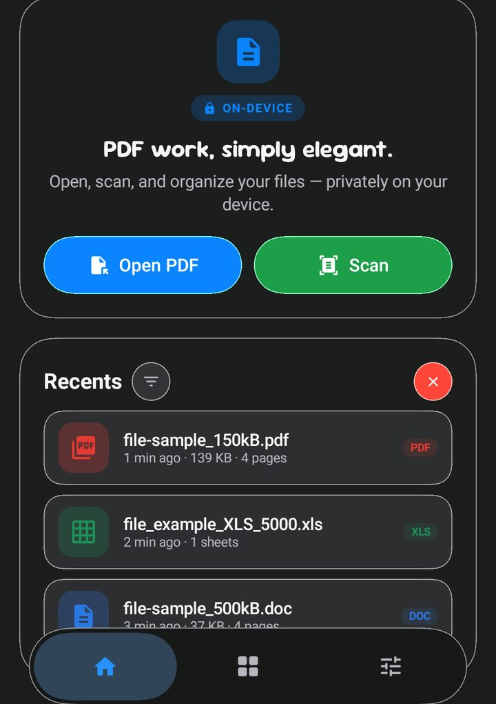
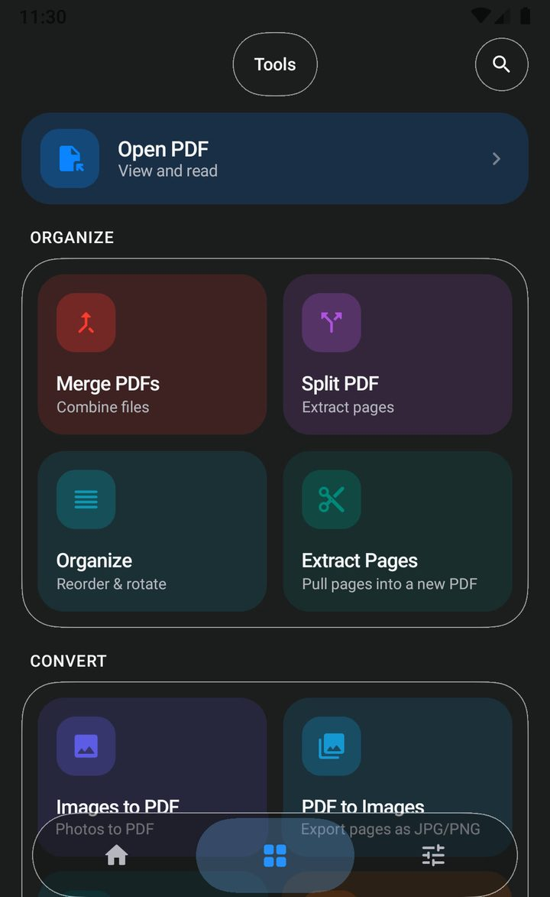
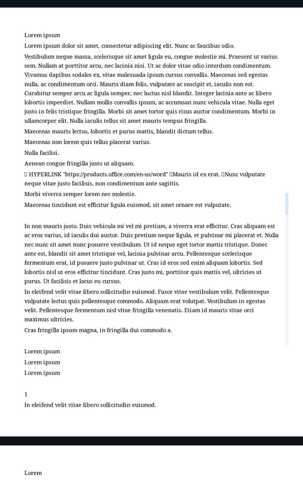
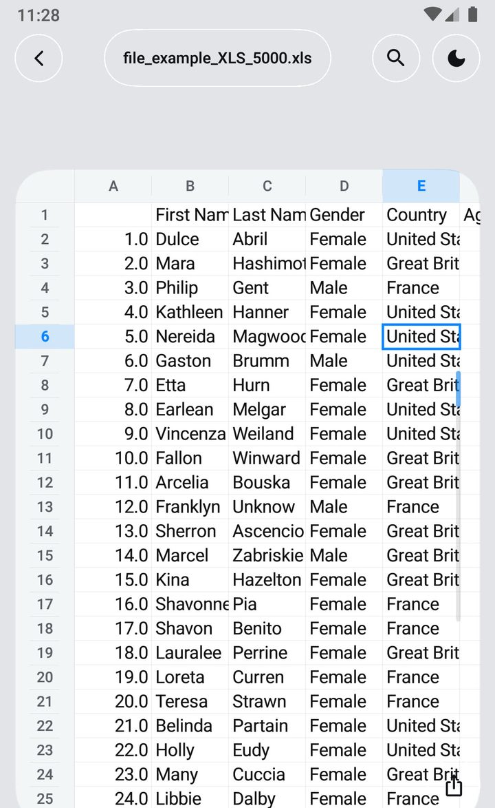
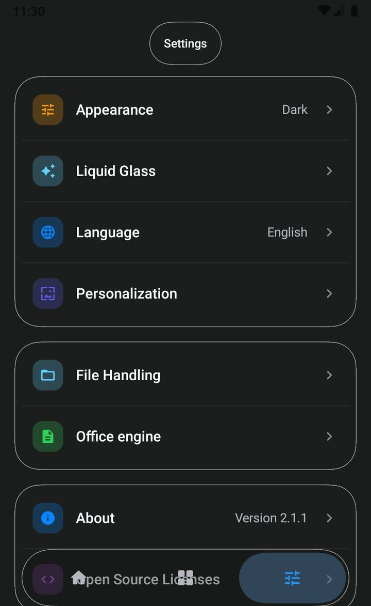

<div align="center">


# HMXPDF

**An open-source PDF and DOCX document toolkit for Android.**

Read, annotate, and sign PDFs, edit Word and Excel documents, scan paper, run
on-device OCR, and create PDFs — all from your phone. Built with Kotlin and
Jetpack Compose.

[Official website](https://hmxpdf-website.vercel.app) ·
[Features](https://hmxpdf-website.vercel.app/features) ·
[Documentation](docs/) ·
[Contributing](CONTRIBUTING.md) ·
[Report a bug](https://github.com/HMXPANEL/HMXPDF/issues/new?template=bug_report.yml)

[](https://github.com/HMXPANEL/HMXPDF/actions/workflows/android.yml)
[](LICENSE)


</div>

> See [GitHub Releases](https://github.com/HMXPANEL/HMXPDF/releases) for published
> signed builds. Debug CI artifacts are not official releases.

## Overview

HMXPDF is an Android application for working with the documents people actually
receive: PDFs, Word files, spreadsheets, scans, and images. It is designed around
three principles:

- **Local by default.** Documents are opened, edited, and saved on the device.
  There is no account system, no upload service, no advertising, and no analytics SDK.
- **Useful depth without pretending.** PDF annotation, forms, signatures, page
  operations, DOCX editing, XLSX cell editing, and OCR are implemented features
  with documented limits — not checkboxes.
- **Open source.** The app is MIT-licensed, with every third-party component and
  its obligations listed in [THIRD_PARTY_NOTICES.md](THIRD_PARTY_NOTICES.md).

## Screenshots

<p align="center">
  
  
  
  
</p>
<p align="center">
  
</p>

## Features

### Read and search PDFs

- Continuous scrolling and paged reading, pinch-to-zoom, page navigation, and
  reading-position memory.
- Night pages, margin cropping, and book-mode layouts for long reading sessions.
- Text selection and copy, in-document search, and page bookmarks.

### Annotate, fill forms, and sign

- Highlights, underlines, strikethroughs, ink, shapes, arrows, and sticky notes.
- AcroForm field viewing and filling, form flattening, and signature stamps with
  a reusable signature library.
- Export an annotated copy without altering the original file.

### PDF page tools and conversions

- Reorder, rotate, delete, and extract pages; merge and split documents.
- Compress to a smaller copy, encrypt or decrypt a copy, add page numbers or
  watermarks, and export pages as images.
- Extract embedded text, create searchable PDFs from OCR, and build PDFs from
  text, images, or local HTML.

### Scan and recognize text

- Multi-page capture with Google ML Kit Document Scanner, page adjustment, and
  save-to-PDF.
- On-device OCR using bundled ML Kit text recognition, with an offline Tesseract
  fallback. Image-only PDF pages can be recognized too.

### Open and edit DOCX documents

- Open DOCX files and edit rich text, table cells, headers and footers, and
  section page setup.
- Find and replace, comments, track-changes review, offline spell check, and
  read-aloud through the device text-to-speech engine.
- Export the edited document to PDF, or save the DOCX back to the file you own.

### Edit and save XLSX workbooks

- Edit cell values and apply styling, borders, and row/column operations.
- Formulas are preserved and recalculated by the spreadsheet application that
  opens the saved file; HMXPDF does not ship a general local formula evaluator.
- Save back to XLSX. Other spreadsheet formats are viewed, not edited.

### Open common Office and text files

- View DOC, XLS, PPT, PPTX, ODT, ODS, ODP, RTF, CSV, and TXT files.
- The optional LibreOffice-based engine improves rendering for supported Office
  formats; it is a separate download and is not bundled in the APK.

### Edit images and create documents

- Crop, rotate, straighten, and perspective-correct photos.
- Adjust colour and tone, apply filters, draw, add text or watermarks, and resize.
- Remove backgrounds on supported devices through Google Play services.
- Create a PDF from images, text, local HTML, or — in the FOSS build — a web
  address you enter.

### Honest limits

| Area | Limit |
|---|---|
| Printed PDF text | HMXPDF annotates, signs, fills forms, and manages pages, but it does not reflow text already printed into a PDF page. |
| DOCX editing | Focused editing, not full Microsoft Word parity. Complex documents may open some parts read-only; review important files after saving. |
| Spreadsheets | Only XLSX supports cell editing and saving. Other spreadsheet formats are view-only. |
| Presentations | PPT and PPTX are viewed and exported to PDF; slides are not edited in their original format. |
| Google Play services | Scanning, subject segmentation, and some ML Kit components depend on Google Play services. Read-aloud depends on the device TTS engine. |
| Office fidelity | Rendering varies by document and renderer. The optional LibreOffice-based engine is downloaded on request, never bundled. |

## Supported formats

| Type | Formats | Read | Edit / save |
|---|---|---|---|
| Documents | PDF | Yes | Annotate, fill forms, sign, organize pages, export |
| Documents | DOC, DOCX | Yes | DOCX rich text, tables, comments, find and replace |
| Spreadsheets | XLSX | Yes | Cells, styles, rows and columns |
| Spreadsheets | XLS | Yes | View only |
| Presentations | PPT, PPTX | Yes | View and PDF export |
| OpenDocument | ODT, ODS, ODP | Yes | View and PDF export |
| Text | RTF, CSV, TXT | Yes | View and PDF export |
| Images | PNG, JPEG, WebP, BMP, HEIC | Yes | Image editor, PDF creation |

Rendering fidelity depends on the format and the renderer in use. See
[Features](https://hmxpdf-website.vercel.app/features) for the user-facing view of
the same capabilities.

## Technology stack

| Layer | Choice |
|---|---|
| Language | Kotlin 2.3 |
| UI | Jetpack Compose 1.10, Material 3, custom liquid-glass components |
| Build | Android Gradle Plugin 9.0, Gradle wrapper, JDK 17 |
| PDF engine | Android `PdfRenderer`, Apache PDFBox for Android, custom `pdf-core` module |
| OCR | Bundled ML Kit text recognition, Tesseract4Android fallback (`ocr-core`) |
| Documents | OOXML parsing and writing in Kotlin, `docx-preview` in a sandboxed WebView |
| Images | GPUImage, local image-processing engine adapted from ImageToolbox |
| Office engine | Optional LibreOffice-based bundle, downloaded on request |
| Minimum SDK | API 23 (Android 6.0) |
| Target / compile SDK | API 36 |

## Architecture

HMXPDF is a multi-module Gradle project:

```text
Hmxpdf/
├── app/            Android app: Compose UI, navigation, viewers, editors, tools
├── pdf-core/       PDF rendering, page operations, text, security, forms
├── ocr-core/       On-device OCR engines and PDF text stamping
├── backdrop/       Shared liquid-glass surface and motion components
├── office_engine/  Optional LibreOffice binaries for Play bundle builds
├── docs/           Engineering audits, phase reports, and this documentation
├── fastlane/       Store metadata
└── hmxwebsite/     Official static website (deployed on Vercel)
```

- The **app** module owns UI state and document sessions. View models coordinate
  reading, editing, saving, and export.
- **pdf-core** exposes stateless document operations (merge, split, compress,
  encrypt, watermark, rasterize) used by the app and covered by JVM tests.
- **ocr-core** wraps OCR engines behind one interface and stamps recognized text
  into searchable PDFs.
- **office_engine** is intentionally not bundled in the APK. It can carry the
  ARM-only LibreOffice binaries for Play bundle builds; at runtime the app installs
  the engine through its own verified download when the user asks for it, and the
  `fdroid` build does not offer it.

## Installation

### Official release (recommended)

When a signed release is available on [GitHub Releases](https://github.com/HMXPANEL/HMXPDF/releases),
choose the APK for your device and compare its SHA-256 with the published checksum.
Most modern phones use arm64-v8a; use the universal APK if unsure.

### From source

Build a debug APK and install it with ADB:

```bash
git clone https://github.com/HMXPANEL/HMXPDF.git
cd HMXPDF
./gradlew :app:assemblePlayDebug
adb install -r app/build/outputs/apk/play/debug/app-play-universal-debug.apk
```

The debug build is ABI-split with a universal fallback, so the same folder also
contains `app-play-arm64-v8a-debug.apk`, `app-play-armeabi-v7a-debug.apk`, and
x86 variants if you prefer a smaller install.

The `play` and `foss` flavors share the same application ID (`com.hmx.pdf`) and
install over each other. The `foss` flavor is the sideload build with the
downloadable Office engine; the `play` flavor targets Google Play delivery.

### From CI

Every successful run of the **Android build** workflow uploads a
`hmx-pdf-debug-apk` artifact. Open the
[Actions tab](https://github.com/HMXPANEL/HMXPDF/actions/workflows/android.yml),
choose the latest green run, and download the artifact. CI artifacts expire and
are debug-signed — they are for testing only.

### APK downloads

Official APKs are published individually on [GitHub Releases](https://github.com/HMXPANEL/HMXPDF/releases).

## Build instructions

### Requirements

- Android Studio with **JDK 17** (the Gradle toolchain targets Java 17).
- Android SDK Platform **36** and Build Tools **36.1.0**.
- A device or emulator running Android 6.0 (API 23) or newer.

### Common tasks

```bash
./gradlew :app:assemblePlayDebug      # debug APK, Play flavor
./gradlew :app:assembleFossDebug      # debug APK, FOSS sideload flavor
./gradlew :app:assembleFdroidDebug    # FOSS-only flavor without Play services
./gradlew :app:assembleFossRelease    # ABI-split release APKs (sideload)
./gradlew :app:bundlePlayRelease      # Play App Bundle
```

Unit tests and lint, as run in CI:

```bash
./gradlew testPlayDebugUnitTest :pdf-core:test :ocr-core:test
./gradlew lintPlayDebug
```

### Release signing

Release builds read signing credentials from a local `key.properties` file. Copy
`key.properties.example` and fill in your own keystore path and passwords; never
commit the copied file or a keystore. Without credentials the Gradle build falls
back to the debug signing key and prints a warning — a debug-signed build is not
an official release.

The CI release job uses the protected `release` environment and its repository
secrets (`CLEARPDF_UPLOAD_*`, inherited names kept for compatibility with the
workflow). It builds signed artifacts only for tag pushes, manual dispatch with
`build_signed_release=true`, and pushes to
`release/hmxpdf-2.1.1-build`. It does not create GitHub Releases.

## Privacy and security

- No accounts, no advertising, no analytics, no crash-reporting SDK.
- Documents are processed on-device; there is no HMXPDF document-upload server.
- Network access is limited to the optional Office engine download, URL-to-PDF
  in the FOSS build, and Google Play services components.
- See [PRIVACY.md](PRIVACY.md) for the full data-flow description and
  [SECURITY.md](SECURITY.md) for private vulnerability reporting.

## Contributing

Bug reports, documentation fixes, and focused pull requests are welcome.

- Read [CONTRIBUTING.md](CONTRIBUTING.md) for setup, branch, review, and testing
  expectations.
- Follow the [Code of Conduct](CODE_OF_CONDUCT.md).
- Report security issues privately as described in [SECURITY.md](SECURITY.md).
- Use the issue templates: [bug report](.github/ISSUE_TEMPLATE/bug_report.yml) or
  [feature request](.github/ISSUE_TEMPLATE/feature_request.yml).

## Project status and history

- **Version:** 2.1.1 (`versionCode` 6), package `com.hmx.pdf`.
- **Primary development branch:** `release/hmxpdf-2.1.1-build` (GitHub default).
- **Backup branch:** `main` — a snapshot updated only on explicit request, never
  used for development. See [docs/BRANCHING.md](docs/BRANCHING.md).
- **Continuous integration:** see the Android build workflow badge above.
- **Account migration:** [migration report](docs/HMXPDF_ACCOUNT_MIGRATION_REPORT.md).
- **Changelog:** [CHANGELOG.md](CHANGELOG.md), derived from the repository's Git
  history.
- **Documentation audit:** [docs/DOCUMENTATION_AUDIT.md](docs/DOCUMENTATION_AUDIT.md).
- **Licensing audit:** [docs/LICENSING_AUDIT.md](docs/LICENSING_AUDIT.md).

## Acknowledgements

HMXPDF is derived from **ClearPDF** by [Chethan616](https://github.com/Chethan616),
which is itself built on the PdfCraft Android project by the ArtCraft Team and the
PdfCraft engine by storytold and contributors. The upstream copyright notice is
preserved in [LICENSE](LICENSE); inherited attributions are kept in [NOTICE](NOTICE)
and [THIRD_PARTY_NOTICES.md](THIRD_PARTY_NOTICES.md).

Key third-party components:

- [Apache PDFBox for Android](https://github.com/TomRoush/PdfBox-Android) — Apache-2.0
- [AndroidLiquidGlass](https://github.com/Kyant0/AndroidLiquidGlass) — Apache-2.0
- [AndroidLiquidGlassView](https://github.com/QmDeve/AndroidLiquidGlassView) — MIT
- [ImageToolbox](https://github.com/T8RIN/ImageToolbox) — Apache-2.0 (adapted image editor)
- [GPUImage for Android](https://github.com/cats-oss/android-gpuimage) — Apache-2.0
- [Tesseract4Android](https://github.com/adaptech-cz/Tesseract4Android) — Apache-2.0
- [docx-preview](https://github.com/VolodymyrBaydalka/docxjs) — Apache-2.0
- [JSZip](https://github.com/Stuk/jszip) — MIT
- [LibreOffice](https://www.libreoffice.org/) — MPL-2.0 (optional, separately downloaded engine)
- [Gander](https://github.com/mokshablr/gander) — MIT (night-mode ideas and constants)

## License

HMXPDF is distributed under the [MIT License](LICENSE). The license text and the
original copyright notice are preserved. Third-party components remain under
their own licenses; see [THIRD_PARTY_NOTICES.md](THIRD_PARTY_NOTICES.md).

## Links

- Website: <https://hmxpdf-website.vercel.app>
- Repository: <https://github.com/HMXPANEL/HMXPDF>
- Releases: <https://github.com/HMXPANEL/HMXPDF/releases>
- Issues: <https://github.com/HMXPANEL/HMXPDF/issues>
- Privacy: [PRIVACY.md](PRIVACY.md)
- Security: [SECURITY.md](SECURITY.md)
- Support: <https://hmxpdf-website.vercel.app/support>
