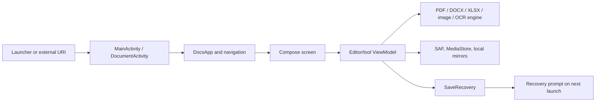

# HMXPDF architecture audit

Evidence: source inspection; no builds or application execution. `A/` denotes `app/src/main/java/com/hmx/pdf/`.

## Execution and composition

There is no custom Application declared in `app/src/main/AndroidManifest.xml:36`. `MainActivity.onCreate` applies locale, routes external documents, launches stale-decryption cleanup and composes `DocsApp` (`A/MainActivity.kt:32–135`). `DocumentActivity` subclasses it to represent separate document tasks (:10). Both activities handle orientation/screen-size configuration changes in the manifest; that reduces ordinary rotation recreation but does not protect process death or other recreation.

`DocsApp` owns shell preferences, onboarding and recovery dialogs. `DocsNavGraph` contains typed-by-string routes and explicit ViewModelProvider factories (`A/ui/navigation/DocsNavGraph.kt:219,525,640`). Dependency injection is manual: four domain use cases wrap services and `PdfServiceLocator` lazily owns shared renderer/text/OCR instances (`A/data/repository/PdfServiceLocator.kt:22–32`). No Hilt/Dagger or domain repository interface layer was found.

## State ownership

| Area | Actual state | Consequence |
|---|---|---|
| PDF | StateFlow in VM; markup/undo maps in Compose `remember` (`PdfViewerScreen.kt:469–540`) | Rendering survives VM lifetime; annotations are not durable session state and can be lost on composition/activity/process recreation |
| DOCX | Compose mutableStateOf for immutable body snapshots (`DocxEditorViewModel.kt:69–79`) | Same-frame text editing and structural sharing; 200-step body undo with 1.5 s typing coalescing (:208–245) |
| DOCX parts | Plain HashMaps and Boolean/String overrides (:588–605) | HF/settings changes are not observable Compose state and are excluded from body undo; save capture not atomic across all parts |
| XLSX | Mutable workbook and EditOp history with StateFlow version bump (`SpreadsheetViewModel.kt:143–178`) | Writer replays full operation history; history cannot simply be truncated without rebasing |
| Image editor | Operation history plus single-thread render pipeline (`ImageEditorViewModel.kt:208`; `EditPipeline.kt:20–96`) | GPU work serialized; preview caches six operation outputs, full render bounded by heap budget |

## Storage and lifecycle

SAF documents use persistable permission attempts; temporary external grants can fail those attempts. `LocalDocumentMirror.localFile` creates a writable local source for editors and refreshes it on load (:88–99). Viewer mirroring is deferred (:129). This is access durability, not unsaved-edit recovery. Editors share mirrors keyed by source URI; concurrent sessions and mirror replacement deserve explicit ownership tests.

SharedPreferences stores recents, pins, progress, theme, locale and save location (`Preferences.kt:29,147,194`). Signatures are PNGs under filesDir/signatures (`SignatureManager.kt:16`). There is no Room/DataStore migration history. Output creation logic is repeated across many tool VMs. SaveRecovery covers DOCX/XLSX saves; PDF Save Copy has a separate backup routine inside the screen (:207). Unifying ownership/validation contracts is preferable to adding another writer.

Heavy operations usually dispatch to IO/Default or `AppDispatchers.pdf` (pool capped at four, :20). WorkManager is used for engine download, not low-latency document saving. Office conversion runs through Messenger in `:office`, a separate process with the same UID, not an Android isolated-UID sandbox (`OfficeEngineService.kt:24–26`; manifest:198).

## DOCX engine and compatibility boundaries

`DocxReader.read:56` reads XML/relationships and selected media, locates the main part through root relationships, models paragraph/table blocks and preserves raw unsupported content. `DocPara.origin` and `DocTable.origin` keep untouched XML. Field instructions lock paragraph editing; Strict OOXML/non-`w:body` is read-only (:91–95,229). `mapContainerOf:150` rebuilds only the path to an edited paragraph, including nested tables.

`DocxWriter.write:25` is the sole native DOCX write path. It reconstructs the document body and streams other ZIP entry payloads, patching styles, numbering, comments, headers, footers and settings only when needed. “Byte preserving” describes retained XML/payloads, not identical ZIP archive bytes or metadata: `rewrite:181` creates new ZipEntry objects and recompresses. Unsupported constructs in edited paragraphs are not universally preserved semantically; comment markers are relocated, HF namespaces are lost, and prefix assumptions remain (FA-03/07).

Rendering is coupled to UI: `DocxPdfWriter` reuses `DocxLook`, `flatten`, and table helpers from the screen. It uses one `pkg.page` geometry (:71), not a full per-section layout engine. Office/WebView/Canvas fallbacks serve different fidelity levels. This duplication has a functional purpose but needs explicit shared contracts and a compatibility corpus.

## Findings and recommended boundaries

- FA-04/05: introduce one immutable save/session snapshot containing body, parts, comments/settings, revision identity and generation. Mark exactly that generation saved; keep UI mutations on the owner thread.
- FA-08: use renderer session handles/refcounts rather than a process-wide URI-keyed owner map. Opening/closing the same URI from two windows must not invalidate the other window.
- FA-01: centralize export staging and provider path policy; keep narrow share directories and stop falling back to file URIs.
- FA-09: search needs cancellable generation-aware work and incremental results, not one coroutine per page plus a no-op full-search branch.
- FA-16/18: bounded archive readers and byte-budget caches; bounded history must preserve writer replay semantics.
- Keep existing Compose UI, manual injection and established document writers. Extract storage/session interfaces incrementally with behavior tests; do not introduce a heavy framework solely for architectural uniformity.

## Dead code and coupling assessment

`PdfViewerViewModel.searchText:875–884` contains a no-op coroutine. `searchTextInDocument:887` has an implementation but the user-facing search bar calls the other method. Dynamic-feature registration is inconsistent with the conditional module. Stale compressor/creator comments incorrectly say “stub.” These are confirmed examples, not a whole-program dead-code proof. No circular module dependency was established; UI-to-engine coupling and duplicated export helpers are the dominant maintainability concerns.
