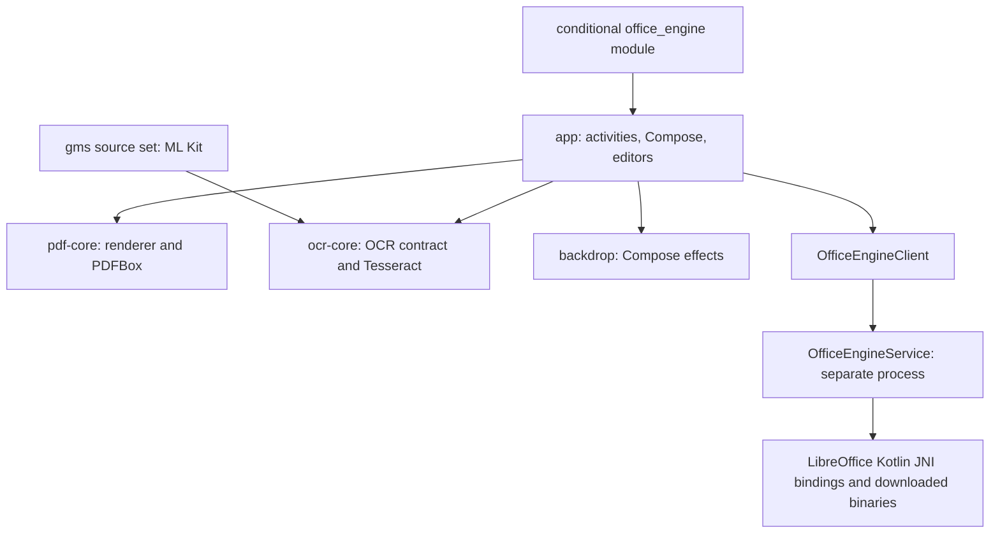

# HMXPDF complete project structure

Evidence scope: all filesystem paths inventoried; major execution paths inspected in source. Generated binaries, resolved dependency internals, and device behavior were not available. This is not a claim that every line of vendored/minified code has undergone a security proof.

## Modules and actual dependency graph

| Module | Files / Kotlin files / Kotlin lines | Purpose and evidence |
|---|---:|---|
| `app` | 360 / 298 / 72,272 | Activities, Compose UI, ViewModels, DOCX/XLSX parsing and patch writing, storage, Office integration, image editor; `app/build.gradle.kts:217–276` |
| `pdf-core` | 35 / 31 / 3,976 | Android PdfRenderer plus PDFBox services; `pdf-core/build.gradle.kts:30–38`, `viewer/PdfViewer.kt:69` |
| `ocr-core` | 8 / 3 / 141 | OCR interface, injected primary recognizer, English Tesseract fallback; `ocr-core/build.gradle.kts:38–47` |
| `backdrop` | 32 / 26 / 2,465 | Local Compose glass rendering/effects library; `backdrop/build.gradle.kts:34–39` |
| `office_engine` | 2 / 0 / 0 | Conditional dynamic-feature binary preparation module; `office_engine/build.gradle.kts:75–218` |

Counts include tests. Total Kotlin lines: 78,854. Module directory counts exclude top-level files/assets outside modules. `app` depends on `backdrop`, `pdf-core`, and `ocr-core` (`app/build.gradle.kts:238–240`). OCR does not depend on PDF. `office_engine` depends on `app` (`office_engine/build.gradle.kts:59–60`), but the app does not declare an active dynamic-feature registration. No source-level cyclic module dependency was established.

## Source sets and responsibilities

- `app/src/main`: application shared implementation, manifest, resources, DOCX WebView assets. `app/src/test`: 39 JVM test files.
- `app/src/gms`: ML Kit OCR, Google scanner and subject segmentation, explicitly included for Play and FOSS (`app/build.gradle.kts:149–154`).
- `app/src/foss`: network permissions and large-heap manifest addition.
- `app/src/fdroid`: camera-app scanner, no primary ML Kit OCR, disabled background removal and Office installer. The Office flavor duplicates the `main` declaration; see FA-02.
- `pdf-core/src/main` and `src/test`: processing implementations and five JVM test files.
- `ocr-core/src/main`: recognition and `assets/tessdata/eng.traineddata`; no tests.
- `backdrop/src/main`: effect scopes, recorded layers, runtime shader cache, blur/lens/color/shadow modifiers. Blur returns without applying the effect below API 31 (`effects/Blur.kt:20`). No tests.
- `office_engine/src/main`: dynamic feature manifest; generated binary directories configured by its build script. No checked-in native payload or tests.
- No `androidTest` source sets were found.

## Application packages

All paths below are under `app/src/main/java/com/hmx/pdf/` unless stated otherwise.

| Path | Responsibility / execution relationship |
|---|---|
| `MainActivity.kt`, `DocumentActivity.kt` | Launcher and external-document tasks, locale initialization, MIME routing |
| `ui/DocsApp.kt`, `ui/navigation/DocsNavGraph.kt` | App shell, onboarding/settings state, recovery prompt, navigation and manual ViewModel factories |
| `ui/screen/` | PDF, DOCX, spreadsheet, image editors; scan, tools, settings, share/print dialogs |
| `ui/viewmodel/` | Editor state, operation dispatch, export, PDF cache/search/OCR coordination |
| `data/repository/` | SharedPreferences managers, local mirrors, save recovery, bookmarks and signatures |
| `domain/usecase/` | Four thin PDF service wrappers: open, merge, create, compress |
| `docx/` | Raw-preserving block model; reader, edits, revisions, comments, XML/property and section helpers; sole DOCX package writer |
| `utils/xlsx/` | Sparse workbook, styles/colors/fonts, edit operations, reference shifts, ZIP patch writer and Canvas painter |
| `utils/` | Format routing, legacy POI extraction, PPTX drawing, DOCX WebView conversion, print adapter |
| `util/` | HTML/URL-to-PDF WebView and offline request filter |
| `office/` | Installer, WorkManager download, checksums, tar extraction, store, IPC service/client and JNI startup |
| `imageeditor/engine/` | Immutable operation descriptions, render pipeline, GPU/CPU filters, image I/O, EXIF, drawing |
| `imageeditor/thirdparty/` | Adapted crop/perspective/gesture primitives; attribution in THIRD_PARTY_NOTICES.md:81 |
| `ui/selection/` | PDF viewport coordinates, text selection state and contextual toolbar |
| `ui/components/`, `ui/theme/`, `ui/utils/` | Existing glass UI, themes, motion, locale and dedicated PDF dispatcher |
| `org/libreoffice/kit/` | Kotlin external/native bindings, not native implementation source |
| `android/print/PrintAdapterCallbacks.kt` | Adapter callbacks used by WebView print flow |

There is no Room schema, DAO, DataStore store, Hilt/Dagger setup, backend service module, admin module or authentication subsystem in the inventoried source. Persistent app metadata uses SharedPreferences and files, not a relational database. WorkManager's dependency-internal database is distinct from an application Room architecture.

## Resources and repository support

`app/src/main/res` contains default and Arabic, Spanish, Italian, Portuguese, Brazilian Portuguese and Russian strings, themes, icons, Carlito/Sour Gummy fonts, wallpaper images, locale configuration, shortcuts, provider paths and backup rules. UI includes hardcoded operational errors alongside localized labels, e.g. `DocxEditorViewModel.kt:741–742`.

Assets include `docx/index.html`, docx-preview 0.4.0 and JSZip 3.10.1, with versions attributed by `THIRD_PARTY_NOTICES.md:61–79`. OCR bundles English trained data. Root `android_icon`, `screenshots`, `demo`, `fastlane` provide distribution artwork/media. `fdroid/` contains inherited ClearPDF release metadata. `.github/workflows/android.yml` is the sole workflow. `docs/` contains historical audits and phase reports; they are evidence of claims, not current test execution.

## Maintainability hotspots

`PdfViewerScreen.kt` has 3,004 lines, `DocxEditorScreen.kt` 2,313, `PdfViewerViewModel.kt` 1,406, `SpreadsheetViewerScreen.kt` 1,257 and `DocxEditorViewModel.kt` 913. Rendering, state, storage and user actions are concentrated in these files. Prefer extraction around verified defects and explicit interfaces; a wholesale architecture rewrite is not justified by size alone.
