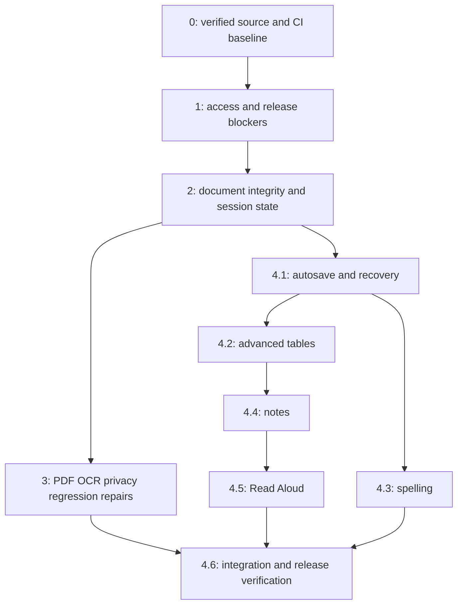

# HMXPDF master implementation roadmap

Planning only. No implementation is authorized by this document. Keep Android builds and release verification in GitHub Actions; do not build APK/AAB locally on the development device. No delivery dates are invented.

## Sequence and gates

Read Aloud can be developed earlier for body text after session identity is stable; full note-aware reading depends on notes. Table completion is not intrinsically required for notes, but shared anchor/grid regression work should land before combining them.

## 0 — Establish a reproducible baseline (medium)

Objective: associate an authorized Git checkout with this source fingerprint and obtain actual CI evidence. Inspect identity report, settings/build scripts, workflow and all test source sets. Do not guess a commit from historical documents. Deliver CI test XML/lint/merged manifests/dependency inventory for each supported flavor, with explicit pass/fail/skip counts. Replace empty test bodies with real future tests only in authorized implementation work; simply removing Ignore is insufficient. Gate signed artifacts on test/lint/guard success (FA-20). Acceptance: source identity and artifact lineage reproducible, no skipped case counted passed. Risk: flavor-specific configuration exposes existing failures; that is useful evidence, not a reason to hide variants.

## 1 — Repair access and compatibility blockers (medium)

Scope: FA-01/02/19. Inspect provider XML, all getUriForFile callers, SpreadsheetScrolling.shareFile, image/raster producers, Office flavor source sets and PDF overlay color conversion. Proposed new component: scoped export staging helper with ownership/cleanup contract, only if consolidation reduces repeated logic. Keep current package ID. Sequence: provider producer/consumer table → narrow staging/internal paths → remove file URI fallback → flavor source separation → API-compatible colors. Tests: provider URI/grant integration, recipient open, encrypted PDF valid/wrong password, image exports, patched DOCX/XLSX share, compile every flavor and API-23 overlay test. Acceptance: no original-file exposure expansion or silent failure. Blocking dependency: CI baseline.

## 2 — Repair document integrity and session state (high)

Scope: FA-03/04/05/06/07/18/22. Inspect DocxModel/Reader/Writer/Edits/Comments/PageLayout, editor VMs, SaveRecovery and HF panel. Proposed data models: immutable EditorSnapshot(body, partStates, settings, anchors, generation), part namespace envelope, document-scoped ID allocator and save request snapshot. Names are proposals, not existing classes. Repository/save coordinator owns serialization and durable journal; VM owns command order/undo/dirty state; UI observes immutable state.

Sequence: namespace-preserving HF writes and lookup → marker offset model → package-inclusive undo → immutable save capture and truthful acknowledgement → XML/package validation and conflict policy. Use existing sole DOCX writer; retain unsupported part payloads. Tests: create/remove/undo/save/reopen HF, image namespaces, explicit false settings, section terminator insertion, concurrent slow saves with edits, crash/disk-full/provider change. Acceptance: no dangling reference/unbound namespace, exact saved generation, dirty remains for later edits, unknown payloads preserved, Word/LibreOffice reopen clean. Risk: changes affect all DOCX mutation paths; broad engine+VM+device regressions required.

## 3 — PDF/OCR/privacy and performance repairs (high)

Scope: FA-08/09/10/11/12/13/14/15/16/17/23/24. Prioritize renderer ownership, search freshness, export transforms, success postconditions and backup policy. Then bound package expansion, cache growth, HTML lifecycle and engine reinstall transactions. Inspect PdfViewer/VM/Screen, PdfTextService, raster/form services, OCR engines/cache, Office store/client, HTML converter, mirrors and backup XML.

Tests: same-URI multiwindow; rapid query/close/reopen; rotated CropBox overlays; flatten exceptions; gallery null stream; OCR cancellation; engine rename failure; backup restore; archive quotas; WebView timeout/cancel. Acceptance: error is surfaced rather than success, original survives failures, work cancels without poisoning engine state, active documents are not cleaned up. Native alignment/DTD tests resolve FA-23 before declaring exploitability or compatibility. No new heavyweight framework is required.

## Phase 4.0 — This audit (completed as source planning)

Deliverables: 14 reports, explicit provenance and verification limits, prioritized defects and feature dependencies. Completion means documentation exists and original source is preserved; it does not mean application correctness or phase runtime certification.

## Phase 4.1 — Autosave and document recovery (high)

Prerequisite: phase 2 integrity/session work. Extend SaveRecovery and existing editor save pipelines, not a second writer. Proposed new files: EditorCheckpointStore, AutosaveCoordinator, recovery metadata model and deterministic scheduling tests. Store complete validated DOCX/XLSX checkpoints under noBackupFilesDir keyed by UUID/document identity rather than display name. Metadata: version, original URI/hash, document kind, checkpoint hash/generation, created time and state. Default design: roughly 2-second idle debounce with bounded maximum dirty interval (e.g. 15 seconds), configurable after device profiling. Serialize one snapshot at a time; coalesce newer requests, never cancel a destination write midway merely because typing continues.

Keep last known good checkpoint until new checkpoint is validated and committed. Manual save uses journal/readback for SAF; conflict prompts Save Copy instead of silent replacement. Startup offers recover/discard/later and labels source conflicts. Cleanup excludes active/recoverable sessions; disk-full leaves prior checkpoint intact. WorkManager is optional deferred cleanup only. Undo may restart after recovery unless explicitly persisted; checkpoint includes the current full document state. Acceptance: process kill/restart recovers the last completed checkpoint, no false clean state or corrupted-original replacement. Tests: debounce, concurrent save, interruption at every write boundary, quotas, duplicate names, revoked URI, device restart/force-stop then manual launch.

## Phase 4.2 — Advanced tables (high)

Inspect DocTable/Row/Cell, parser/writer, TableRowBlock, current paragraph commands. Proposed files: table grid validator, table edit kernels, table selection state and contextual panel. Add immutable structural operations for creation, insertion/deletion, merge/split, shading/borders/margins/width/height with validated gridSpan/vMerge. Preserve cell block lists/nested tables/raw properties. Selection UI must fit existing toolbar/dialog architecture. Implement simple rectangular unmerged operations first, merged-grid transforms second. Explicitly gate unsupported structural tracking. Tests: content/format/anchor preservation, grid invariants, undo/redo, save/reopen and external Office. Acceptance: no unrelated XML rewrite and no silent cell loss. Dependency: unified snapshots/anchors and recovery.

## Phase 4.3 — Spell checking (medium–high)

Inspect DocPara.fmts, DocxLook.annotate, replaceRange and mode gates. Proposed engine adapter, locale/range annotations, bounded cache and suggestions panel. Start with verified offline installed Android spell service; expose unavailable state if no suitable service. Do not silently send document text to a network service. Handle cross-run words, mixed language, URLs/numbers/punctuation, tables and supported HF projections. Annotations never change rPr or mark document dirty. Replacement validates current generation/text and uses safe tracked edit pipeline. Tests: stale suggestions, formatting, comments, unsupported fields, incremental cancellation and long paragraphs. Acceptance: user approval required for replacement; no formatting/anchor damage. Dictionary distribution deferred until license/version/APK/memory/maintenance analysis is documented.

## Phase 4.4 — Footnotes/endnotes (high)

Inspect reader relationship resolution, package part snapshots, DocxWriter part edits and section properties. Proposed note models/reader/edit kernels and navigation panel. Preserve reserved separators; allocate independent IDs; insert/delete reference and body atomically; preserve imported namespaces and relationships. Support numbering/section settings only to verified scope. Note body formatting reuses paragraph commands. Tests: existing/missing parts, multiple sections, separator IDs, relationships/content types, undo/recovery, comments interaction and Word/LibreOffice reopen. Acceptance: writer remains sole DOCX output path, no orphan references or unrelated part changes. Dependency: part snapshots, anchors and recovery.

## Phase 4.5 — Read Aloud (medium)

Proposed ReadingProjection and AndroidTtsController, scoped to editor lifecycle. Read ordered body/table/list content and optional notes/HF through stable IDs; exclude nonreadable objects and pending deletions by declared review policy. Add existing-toolbar action with play/pause/resume/stop/paragraph navigation, offline voice availability, language and rate. Pause via stop plus saved chunk offset, accounting for Android callback support. Use bounded chunks, audio focus and generation checks. Default stop on navigation away; background playback requires separate explicit service scope. Tests: fake TTS state machine plus device voice/focus/lifecycle failures and long document. Acceptance: no document mutation/network voice dependency and no stale highlight after edits.

## Phase 4.6 — Integration and release verification (high)

Combine all feature interactions under memory/storage bounds. CI engine/VM/provider/UI suites, raw test reports, supported flavor builds, signing/native checks; device smoke on low-RAM/API23/current/no-GMS and external Office reopen. Verify unsaved edits from tables/spelling/notes recover together; undo matches checkpoint generation; TTS remains read-only and cancels on invalidated content. Record limitations transparently. Acceptance: no unresolved release-blocking P1, no skipped-as-passed accounting, reproducible artifact/source identity and user-facing controls exercised. Do not commit/push/release without later explicit authorization.
